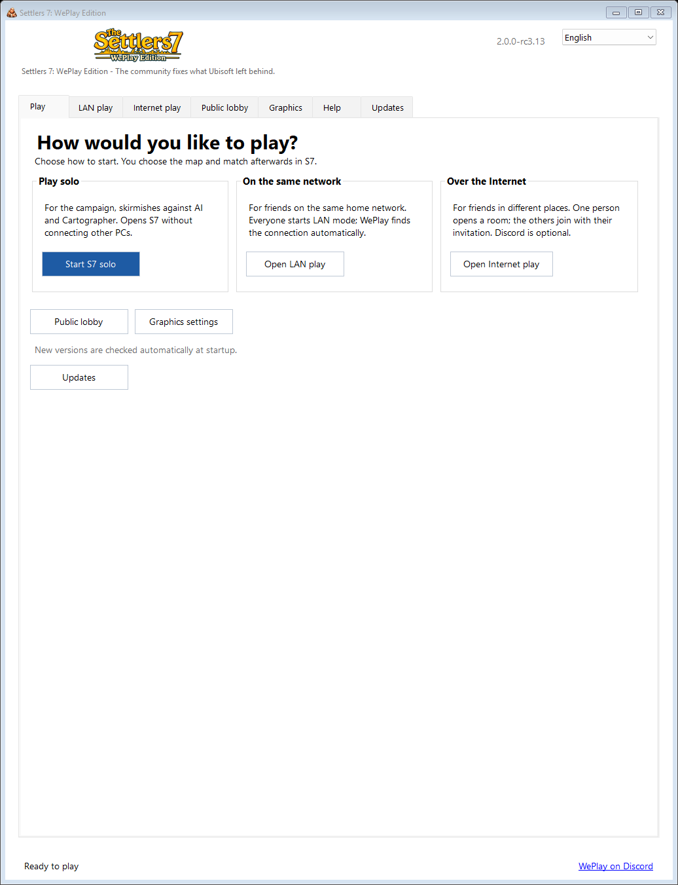

# Settlers 7: WePlay Edition

**The community fixes what Ubisoft left behind.**

Play **The Settlers 7 History Edition** locally, with friends on your home network,
or in private Internet rooms — from one English/German Windows launcher.
WePlay detects your supported game installation, prepares a separate copy and
keeps the original intact. Each player needs their own supported game files.

**RC3.13** adds a **Public lobby** in the launcher and the in-game **WePlay
Online** browser. Published games show their player counts, open slots and
compatibility. Private rooms by invitation remain a separate path and are not
published automatically.

Before each new EasyTier connection, the launcher explains the virtual network,
address visibility and remaining risks, and asks for explicit consent. Browsing
the lobby starts no tunnel. The managed tunnel permits the required game/lobby
ports and their replies, and denies other services and forwarding. It also keeps
your startup options automatically, removing the repeated reset-options question.
See [RC3.13 release notes and limits](docs/RC3.13-PUBLIC-LOBBY.md) and
[directory setup and verification](docs/SHARED-GAME-DIRECTORY.md).

Private standalone exports now also open correctly through **App/S7Launcher.exe**:
the launcher recognizes the bundled game before setup, including after moving
the complete folder. No original installation is needed for a complete export.

Includes **RC3.12** independent maintenance for both Ubisoft and Steam copies:
WePlay detects, repairs and updates its own prepared game after the original
installation is removed. The launcher opens taller menus and expands within
the available screen height. Keep Steam running when using that edition.
See [RC3.12 changes and verification](docs/RC3.12-STANDALONE-MAINTENANCE.md)
and [standalone maintenance](docs/PRIVATE-STANDALONE.md#independent-maintenance-rc312).

Includes **RC3.11** multiplayer saving, continuing saved matches and a host autosave
every five minutes of game time.
It supports the fingerprinted Ubisoft Connect/Uplay and Steam History Edition
builds and includes the logistics crash fix, lobby-alliance correction, standalone startup
recovery and multiplayer castle corrections. Keep Steam running when using that edition.
See [RC3.11 changes and test limits](docs/RC3.11-MULTIPLAYER-SAVES.md) and the
[Steam verification and remaining limits](docs/STEAM-COMPATIBILITY.md).

**[Download RC3.13 ZIP](https://github.com/R4nd0/Settlers-7-WePlay-Edition/releases/download/v2.0.0-rc3.13/WePlay-RC3.13.zip)** · [Setup.exe](https://github.com/R4nd0/Settlers-7-WePlay-Edition/releases/download/v2.0.0-rc3.13/Setup.exe) · [Release notes and checksums](https://github.com/R4nd0/Settlers-7-WePlay-Edition/releases/tag/v2.0.0-rc3.13) · [Join WePlay on Discord](https://discord.gg/j2eQgVzssc)

**Includes RC3.7.1 maintenance:** correct version display and automatic cleanup of older
managed game files, preserving saves and personal files. The safe switch to a
new game copy still temporarily needs extra disk space.
[Maintenance notes](docs/RC3.7.1-MAINTENANCE.md).

**Your castle is back in multiplayer.** RC3.7 restores each player's customized
Castle Forge design inside matches, including its appearance on the other
client. [Castle Restoration: changes and verification](docs/RC3.7-CASTLES.md).

*English RC3.13 launcher, rendered with demonstration data.*

### Development changes — not released yet

Existing-installation updates now stage and verify complete packages, recover
interrupted package/standalone metadata switches, track failed game preparations
and budget archive/save migration space. Complete standalone exports can move
with contained old-version cleanup still pending. See
[update recovery and qualification](docs/UPDATE-RECOVERY.md).

The start page shows four distinct cards: **Solo**, **LAN**, **Private Internet**
and **Public Internet**. The next launcher uses the centrally hosted
[WePlay public directory](https://weplay-multiplayer.weplay-community.workers.dev/health)
automatically and refreshes the visible game list. Public hosting and joining
work without linking Discord. **Also publish on Discord** remains an optional
setting in Public lobby; private rooms keep their invitation-sharing controls.
Per-room consent and network isolation remain enabled. See
[the launcher flows](docs/LAUNCHER-LOBBY-FLOWS.md) and
[central-service verification and test limits](docs/PUBLIC-LOBBY-SERVICE.md).

The service moved to its neutral community address on November 4, 2026. Previous
Discord publisher links were invalidated with the owner's approval. Use
`/weplay-hilfe` to obtain a fresh private linking code if you want Discord
publication. Existing RC3.13 readers can use a fresh directory code from that
helper; the automatic default and Discord-independent hosting require the
unreleased launcher/package changes.

These source changes are not included in the RC3.13 downloads above.

## What you can do

| Feature | Available in RC3.13 |
| --- | --- |
| Local play | Start your prepared game with remembered graphics settings and player name. |
| LAN multiplayer | Discover your LAN group automatically; create or join the actual match inside S7. |
| Public lobby | Browse published games in the launcher or S7; join their private room, then select the native match in S7. Initial reader linking uses the Discord helper. |
| Connection consent and isolation | Read the EasyTier explanation and explicitly agree before each new room connection; unrelated tunnel traffic and forwarding are denied. |
| Internet rooms | Create a private room or join by invitation, using integrated EasyTier. No separate VPN installation, EasyTier account or rented WePlay server is needed. |
| Discord community | Find players, share room invitations and optionally report your public games to the board in #🎮multiplayer. |
| Graphics | Native or Modern (DXVK) graphics, GPU/display selection where supported, window modes and quality settings. |
| Updates | Automatic checks at launcher startup, a visible version/install button and a manual Updates tab. Downloads are verified against a signed manifest. |
| Windows integration | Built-in helpers for discovery, firewall configuration, update installation and cleanup; no PowerShell scripts or execution-policy changes in normal use. |
| Achievement notifications | Repeated achievement popups are suppressed; the achievement catalogue and rewards remain available. |
| Multiplayer castles | Your selected Castle Forge design appears in the match and is transferred to the other players. |
| Multiplayer saves | Host manual saves, an automatic save every five game minutes, and continuing matches from the multiplayer browser. |
| Standalone maintenance | Update and repair your owned Ubisoft/Steam copy without the original installation; local repair inputs stay with the game. |

## Install or upgrade

1. Download and unpack the **RC3.13 ZIP**, or download **Setup.exe** directly. Close S7 and WePlay before upgrading.
2. Run Setup; for an upgrade, use your existing WePlay application folder.
3. For a first installation, select your original supported History Edition. Existing prepared copies can update from their own retained files. A complete private standalone export opens through App/S7Launcher.exe or WePlay-Starten.cmd and needs no Setup or source installation.
4. Install the **same RC3.13 build on every player's PC** before playing together. Clients predating RC3.7 use a different castle message format.

You need Windows x64 (Windows 10 22H2/build 19045 or newer, including Windows 11),
your own supported History Edition and space for a separate game copy.
Python and .NET are bundled. Modern graphics requires a compatible Vulkan GPU;
Native graphics is also available.

Saves and settings are preserved during managed updates. New releases appear
automatically when you open the launcher; install them with **Install update**.
Older launchers need this Setup once. If RC3.4's old update handoff is blocked by
your script policy, run the current Setup directly — **do not change the policy**.

RC3.7 retains clearer start/room guidance, optional DXVK landscape presets
and the simple-menu Kartograph correction. Before switching host roles after
a match, restart both games. Mixed Steam/Ubisoft castle matches passed locally
with either edition hosting. Two physical PCs, Internet castle transfer and
extended/endgame sessions remain unqualified. RC3.10 includes RC3.9's stale
lobby-alliance desync correction and the subsequent native logistics crash fix.
The original replay passed its earlier crash region; a new mixed Ubisoft/Steam
live match had **20,525 matching native turn checksums** and normal exits.
The live memory monitors failed, so continuous memory monitoring remains
unqualified. See [RC3.10 verification and limits](docs/RC3.10-LOGISTICS-CRASH.md).

Windows asks for administrator consent when network adapters or firewall rules
need changing; the game runs without elevation. This preview's installer and
helpers do not yet carry a trusted Windows publisher signature. Windows may
warn or block them; WePlay does not disable SmartScreen, App Control or other
security policies.

## Save and continue multiplayer

The host can use **Save game** in the in-game menu; an automatic checkpoint is
also written every five game minutes. To continue after closing the games,
the same host selects **Multiplayer → Load game**. The other players join in
their original slots and select **Ready**. Wait for the host's **Start** button
to become available while the checkpoint transfers.

Keep the host's profile and save data together. Individual saves copied to a
different profile, older saves without WePlay checkpoint data and Map Forge
templates are not supported. [Save/reload instructions and verification](docs/RC3.11-MULTIPLAYER-SAVES.md).

## Play over the Internet

A WePlay room connects the PCs; the actual match is created afterwards inside
S7. Discord is optional and does not distribute private room invitations.
For the guided development interface, see the [launcher walkthrough (Deutsch)](docs/LAUNCHER-GUIDE.md).

1. Everyone opens **Internet play** and enters their player name.
2. The creator selects **Create room and start** and approves the Windows network permission prompt.
3. Use **Copy invitation**, or **Copy for Discord** to include joining instructions. Share that private invitation only with your intended players.
4. Friends paste it into **Paste your private invitation** and choose **Join room and start**.
5. Inside S7, open **Multiplayer**. One player creates the match and the others join it there.

Keep **Private session** off so the other room members can find the match.
That setting alone does not publish anything on Discord.

The default **No own server · public-assisted** mode uses public EasyTier nodes
for discovery/NAT traversal. Traffic connects directly where possible and may
use a relay when needed. **Direct connections only** avoids public bootstrap,
STUN and relay nodes, but needs a reachable numeric endpoint and will not work
with every NAT/firewall combination.

**Keep the creator PC and WePlay connected while guests use the room.** If the
creator finishes their own game first, WePlay keeps the room open for active
guests. **Close Internet room** closes an idle room. During play, closing the
launcher window keeps it in the system tray.

[Internet room guide](docs/RC3-INTERNET.md)

## Discord: find players and show public games

Join **[the WePlay Discord server](https://discord.gg/j2eQgVzssc)**. The launcher
opens this community with **WePlay on Discord** and suggests invitation code
`j2eQgVzssc`. The community link and a private game-room invitation are different
things. **Copy for Discord** copies a room invitation and instructions; you
choose where to paste/send it.

For the optional automatic game board:

1. In **#🎮multiplayer**, run **`/weplay-hilfe`** and choose **Launcher verbinden**.
2. Paste the private connection code into **Connect to Discord** in the launcher's Internet tab. This code is not a bot token.
3. Review **Automatically show my public games in #🎮multiplayer** before launch. Connecting initially enables it; you can turn it off or disconnect.

Connected launchers can report their own public-game titles, player counts/free
slots and open/full or start/loading signals. Private games and room invitations
are not published. A start/loading signal is not confirmation of an ongoing
simulation. **`/spiele`**, **`/weplay-status`** and **`/weplay-hilfe`** provide the
bot's game/status/help commands. Listings depend on connected launchers and the
external service; a Discord outage does not stop your game.

**The bot runs externally — your PC does not have to stay on to host the bot.**
The creator's PC still needs to stay connected for its actual Internet room.
[Discord setup and listing details](docs/DISCORD-INTEGRATION.md)

## Play on your home network

Connect all PCs to the same trusted private LAN. Open **LAN play**, enter a name
and select **Start LAN play** on each PC. Allow private LAN access if Windows
asks. In S7 **Multiplayer**, one player creates the match and the others join it;
Private game is locked off for LAN creation.

Use matching versions. If graphics profiles differ, start one PC first, then
the others so supported differences can be aligned. If no shared group appears,
check private LAN permission on each PC.

[LAN player guide: English](docs/LAN-PLAYERS.md) · [Deutsch](docs/LAN-SPIELER.md) · [Graphics help](docs/GRAPHICS-START.md)

## Current status

**RC3.8 is an experimental preview; LAN desync remains open.** Two local
Ubisoft/Steam clients played Feuerschlucht with one AI in both host directions,
to turns 3489 and 2858, with matching castle values and no observed desync.
Subsequent local logs from the user's RC3.8 installation confirm another desync
at turn 2122 with four active players on Throne of Tandria.
These same-PC tests do not qualify two humans versus two AI, physical-PC LAN,
Internet gameplay, multiplayer save/reload or extended/endgame synchronization.
The memory monitors reported failures, so clean memory stability is also
unqualified. See [RC3.8 verification and limits](docs/RC3.8-STANDALONE-CASTLES.md).

The Windows helpers, signed updater, real scoped firewall/adapter lifecycle,
separate-copy preparation and save-preserving cleanup have been tested. Those
checks do not establish multiplayer simulation stability.

## Credits

With love and thanks to **[Eisenmonoxid](https://github.com/Eisenmonoxid)**:
your **[S7Patcher](https://github.com/Eisenmonoxid/S7Patcher)** and
**[S7Packer](https://github.com/Eisenmonoxid/S7Packer)** laid the groundwork for
WePlay. ❤️ [Credits and licenses](CREDITS.md) · [MIT license](LICENSE)

Technical documentation and development

[Development and verification](docs/DEVELOPMENT.md) ·
[Windows helpers](docs/WINDOWS-HELPERS.md) ·
[Signed updates and publishing](docs/UPDATES.md) ·
[Native adapter](docs/NATIVE-LOCAL-START.md) ·
[Research and original patcher](docs/LEGACY-PATCHER.md)

Source builds use the .NET 10 SDK and the documented packaging toolchain.
Copied games, runtimes, credentials, agent journals and build outputs are not
source files and must not be committed. EasyTier corresponding source and build
instructions accompany the release.

This is an independent community project. Game names and trademarks belong to
their respective owners. Each player supplies their own supported game copy.
