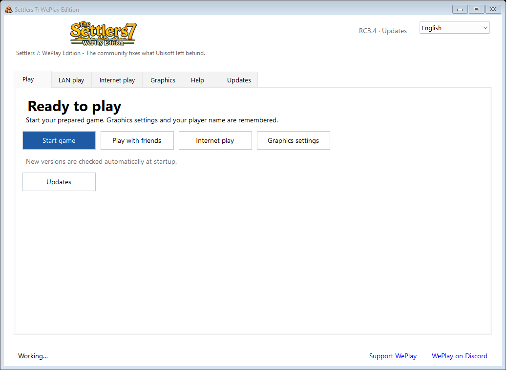

# Settlers 7: WePlay Edition

**The community fixes what Ubisoft left behind.**

A community LAN project for **The Settlers 7 History Edition** on Windows,
built on Eisenmonoxid's S7Patcher. Each player supplies their own supported game
installation. WePlay prepares a separate copy and keeps the original intact.

**[Download RC3.4 — Setup.exe](https://github.com/R4nd0/Settlers-7-WePlay-Edition/releases/download/v2.0.0-rc3.4/Setup.exe)** · [Release notes and checksum](https://github.com/R4nd0/Settlers-7-WePlay-Edition/releases/tag/v2.0.0-rc3.4)

One installer, automatic game detection, one English/German launcher for local
play, LAN, Internet rooms and graphics. RC3.4 suppresses repeated achievement
popups and adds signed updates, checked automatically whenever the launcher starts.
An available update shows its version and an install button on the home page.
Install this bootstrap version once to enable future update detection.
Everyone in a match must use the same prepared RC3.4 version.
This is an experimental RC; see the release notes for the remaining live-test
and multiplayer limits.

*English launcher preview, rendered from the packaged RC3.4 application with demonstration data.*

## Play together

1. Install the same current RC3.4 on every PC connected to the same trusted LAN.
2. For the first test, select Modern graphics (DXVK) on every supported PC.
3. On one PC, enter a name under LAN play and click Start LAN play. Wait for S7.
4. Start LAN play on the other PCs. Allow private LAN access where required.
5. In S7 Multiplayer, one player creates the match with **Private game automatically locked off**,
   and the others join it there.
   This is the only match selection; there are no IP addresses or extra rooms.

**Player guide: [English](docs/LAN-PLAYERS.md) · [Deutsch](docs/LAN-SPIELER.md)**

Discovery finds a shared local service; the actual match is chosen inside S7.
Native/Modern profile differences are guarded and known variants can be aligned
before starting. Different renderers have not been established as the cause of
the known desync. See the player guide for matching rules and troubleshooting.

For Internet play, open **Internet play**, create a room and share its private
invitation with your friends. They join with the same build; choose the actual
match inside S7. Integrated EasyTier needs no account or rented WePlay server.
The default mode uses public discovery/relay infrastructure; direct-only mode
needs a reachable peer. See the [Internet guide](docs/RC3-INTERNET.md).

Join the [WePlay Discord community](https://discord.gg/j2eQgVzssc). The launcher
can share room invitations and optionally connect to the externally hosted game
directory bot. [Voluntary support](https://example.invalid/removed-personal-link) helps R4nd0
R4nd0 and operation of the WePlay bot.

## Current status

**Experimental release candidate, not a guarantee of desync-free play.** Real
two-PC joins and match starts have worked with either computer hosting. A guest
command-delay bug has been corrected. The owner subsequently reported two
three-hour sessions without an observed desync. The exact build, map and
transport were not specified; that observation does not close earlier reverse-host
desync findings or qualify three or more clients, Internet matches and large
endgame networks. Automatic discovery does not fix simulation bugs.
For a first LAN start with different graphics profiles, start one PC first,
then the others; known renderer differences are aligned automatically. With
simultaneous first starts, an incompatible winning service may require retrying
LAN start. No disconnected second group is silently created to hide a mismatch.

- [Getting started with the desktop launcher](docs/RC2-START.md)
- [RC3.4 Internet rooms and launcher features](docs/RC3-INTERNET.md)
- [Signed updates and publishing](docs/UPDATES.md)
- [RC2.1 checkbox verification](docs/RC2.1-QA.md)
- [Automatic LAN, limits and verification](docs/AUTOMATIC-LAN.md)
- [Graphics choices and hardware checks](docs/GRAPHICS-START.md)
- [Two-PC verification](docs/TWO-PC-DELIVERY.md)
- [Development and verification](docs/DEVELOPMENT.md)
- [Original patcher workflow and research history](docs/LEGACY-PATCHER.md)

## With love to Eisenmonoxid

Huge thanks, warm greetings and lots of love to **[Eisenmonoxid](https://github.com/Eisenmonoxid)**.
Your **[S7Patcher](https://github.com/Eisenmonoxid/S7Patcher)** and
**[S7Packer](https://github.com/Eisenmonoxid/S7Packer)** laid the groundwork for
this project. Thank you for opening up the tools, sharing the research and
helping keep this game alive. WePlay builds on your work with gratitude. ❤️

See [credits and licenses](CREDITS.md). The original MIT copyright notice is
preserved in [LICENSE](LICENSE).

## Development

Build the source with the .NET 10 SDK. The Windows launcher and preparation
installer live in `tools/desktop` and `tools/installer`. Read
[development notes](docs/DEVELOPMENT.md) and the
[native adapter documentation](docs/NATIVE-LOCAL-START.md) before changing it.
Local agent instructions and handoff journals are intentionally ignored.
The RC3.5 implementation replaces player-facing PowerShell operations with
[Windows helpers](docs/WINDOWS-HELPERS.md); the download above remains the
currently published RC3.4 release until the next preview is published.
Never commit or distribute copied game files, local account data,
runtimes or private experiment outputs as source.

This repository is an independent community project. Game names and trademarks
belong to their respective owners.
