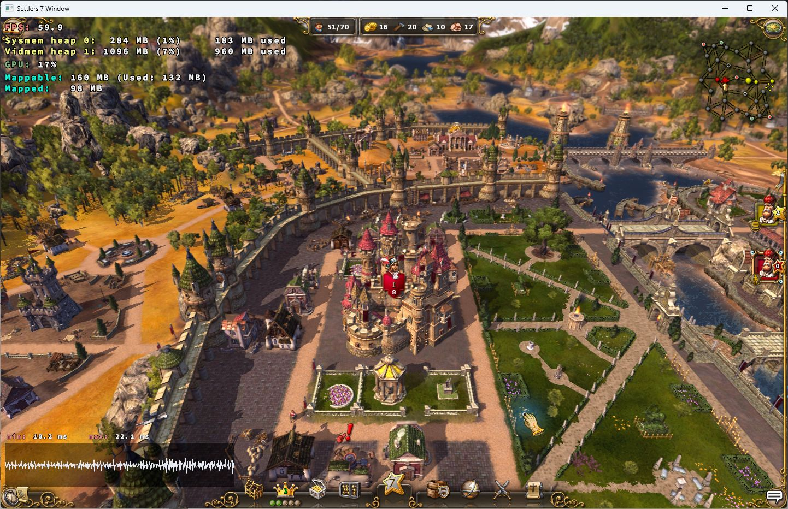

# DXVK image quality, 2026-10-30

The optional **Clear landscape / Klare Landschaft** preset removes the game's
depth-of-field blur and opts into 16× anisotropic texture filtering. It uses
high native shader, texture, view-distance, shadow, water and clutter quality,
medium object detail, game antialiasing, shadows, SSAO, sun shafts and parallax.
**Highest object detail / Höchste Objektdetails** additionally sets object detail
to High. These are optional starting points; existing/fresh preferences keep
their previous behavior until the player selects a preset and saves.

The largest visible change in the PC1 Tanholm comparison is the distant rocks,
trees and paths remaining in focus. AF alone is a smaller change in this view;
it does not recover detail intentionally blurred by depth of field. The native
color palette, water, shadows and UI are retained. No sharpening halo or color
grading shader is added. The higher object setting is optional because the
32-bit game has limited address space and a small static scene cannot predict
the cost of a large settlement.

Before (previous filtering and depth of field) and after (Clear landscape):

These are unedited window captures at the same resolution. The DXVK diagnostic
HUD is enabled only for research; selecting a quality preset does not add it.

## What is actually supported

The installed x86 DLL is still the original DXVK **3.1.1**, SHA256
`265888c31ca78dffa290c39cb7e50bfb02762590e41927906e46fb32f01497fa`.
The real game log confirms both the version and selection of PC1's Radeon
RX 9070 XT. Settings were checked against upstream's pinned
[configuration](https://github.com/doitsujin/dxvk/blob/v3.1.1/dxvk.conf) and
[D3D9 option parser](https://github.com/doitsujin/dxvk/blob/v3.1.1/src/d3d9/d3d9_options.cpp):

| Setting | Decision |
| --- | --- |
| `d3d9.samplerAnisotropy = 16` | New optional child-only override; effective configuration confirmed in the real log. Can affect filtering-dependent passes, so disable it if artifacts occur. |
| `d3d9.floatEmulation = Strict` | Existing measured black-water correction retained in every DXVK launch. |
| `d3d9.maxFrameRate = 60` | Existing owned configuration retained; no unlocked-rate experiment. |
| `d3d9.samplerLodBias`, `clampNegativeLodBias` | Supported, left at defaults. Negative bias can add shimmer; no measured reason to change it. |
| `d3d9.maxFrameLatency`, `dxvk.latencySleep` | Supported, left at defaults. Queue/latency changes need their own pacing evidence; enabling latency sleep can worsen pacing. |
| `d3d9.forceSampleRateShading` | Works with existing MSAA; does not create MSAA in this game. Not enabled. |
| `d3d9.forceSwapchainMSAA` | Absent from the pinned D3D9 parser; not exposed as a working control. |
| `d3d11.*`, HDR, tessellation | No new S7 D3D9 lighting, geometry, HDR or native D3D11 port follows from these switches. |

Native antialiasing remains enabled through S7's existing Effects/Antialiasing
value. This milestone does not claim forced MSAA, supersampling, FSR or temporal
AA. Resolution remains the existing separately selected output resolution;
neither preset silently raises it. Native display resolution can improve fine
detail relative to a smaller window, with higher rendering/memory cost.

Upstream's [driver requirements](https://github.com/doitsujin/dxvk/wiki/Driver-support)
still apply. The existing Vulkan probe selects eligible devices; a GPU model
name by itself is not qualification. Upstream
[does not officially support Windows](https://github.com/doitsujin/dxvk/wiki/Windows).
One AMD Windows device tested here does not qualify other AMD, Intel or Nvidia
hardware. The compatible original D3D9 mode remains available; the AF choice
is retained locally but has no effect there.

## Reproducible local comparison

Only `work/cartographer-review/Game` was run, with its existing exact-image
guards and repaired Kartograph archive. The original installation was not
modified. One game and one bounded measurement ran at a time. Normal priority,
two physical cores / mask `0x5`, 1440×900 windowed, discrete GPU, the same DLL,
Strict water correction and 60-FPS cap were retained. High native settings
already existed in the starting preferences, apart from medium object detail.

A new separately named QA save was made in Tanholm. AF, Clear and Highest
reload that same save and use the same initial camera; no camera movement
occurs during measurement. Screenshots contain normal water/character/particle
animation and slight simulation progress, so they are not pixel-identical
frozen frames. A baseline return run supplies the matched before image.
The first exploratory baseline and five-second menu/setup probe are separate;
the latter included a long interval and is not a steady-state quality result.

Measurements use read-only screen-update counter and timer fields after exact
EXE/engine file hashes, loaded paths/image sizes and ASLR-adjusted code-byte
guards. Only consecutive increments produce individual intervals; missed
increments are counted explicitly. This measures S7 **render-loop completion**,
not successful Vulkan presents or displayed frames. The existing PresentMon
Vulkan event-loss result is not relabelled as valid FPS. The DXVK HUD separately
showed approximately 60 FPS during steady foreground views.

Each map window is 30 seconds, foreground throughout, with no screenshots or
UI input during sampling. The observer used about 0.014–0.025 CPU core. No
interval was missed in the reported map windows. Private recipes, hashes,
screenshots, raw aggregate counters and restoration reports remain under
`work/graphics-quality-20261030`.

| Tanholm window | Loop Hz | p95 / max interval (ms) | Intervals >50 ms | Process CPU (cores) |
| --- | ---: | ---: | ---: | ---: |
| Initial exploratory baseline | 59.764 | 17.009 / 75.160 | 2 | 1.011 |
| AF 16× only | 60.000 | 16.808 / 18.405 | 0 | 0.959 |
| Clear landscape | 59.998 | 16.796 / 18.472 | 0 | 0.986 |
| Highest object detail | 59.995 | 16.806 / 17.998 | 0 | 0.969 |
| Return to baseline, same saved scene | 59.996 | 16.912 / 19.583 | 0 | 1.007 |

All map medians are 16.667 ms. The return run confirms that disabling AF and
restoring depth of field returns the background blur; the improvement is not
attributed to a different camera, output resolution or changed game assets.

Separate 15-second foreground menu checks: the previous simple menu reached
59.994 loop Hz, p95 16.757/max 18.270 ms and 0.315 CPU core. The highest-detail
menu world after leaving Kartograph reached 59.999 Hz, p95 16.726/max 18.868 ms
and 0.752 CPU core. These are different menu modes, not a matched performance
comparison. Both have complete observed loop coverage and no interval >50 ms.

The highest-detail Kartograph smoke test loads its menu world on demand from
the simple menu, opens Waldreich/Standard, shows the populated victory-condition
panel and sector objects, switches categories, and returns to the menu. No
template is edited, saved over or published. Its repaired archive is unchanged.
This verifies rendering/navigation, not another save/edit qualification.

Across all five launches, the sentinel reports no pressure and no monitor
failure; peak private memory per run is 1466–1537 MiB. Startup/menu/editor/exit
are included in these peaks. This does not explain the earlier independent
Kartograph sentinel failure. All five games exit normally and restore their
previous graphics/local preferences.

The short capped windows do not measure uncapped GPU headroom, input latency,
display cadence, large late-game settlements, other maps/GPUs or long-term
stability. Small CPU differences do not establish a speedup. The initial
baseline's two intervals above 50 ms are retained, not attributed to a specific
graphics setting. The existing memory sentinel remains active and unchanged.

## Use and return to the previous image

Open Graphics, choose a preset, inspect the controls, then Save and start the
game. GPU, output, simple menu, resource rules and renderer selection remain
separate. The native game quality values still use the existing allowlisted,
closed-game shared Options.ini update. AF is one strict optional boolean in
the local `graphics-choice.json`; legacy records mean false. It supplies only
the fixed AF override in the verified DXVK child's environment. Parent/service
environments, owned DLL/configuration, restoration journal and content ID are
unchanged by this local filtering choice. No arbitrary config text is accepted.

For the exact tested previous image, turn off **Sharper landscape textures**,
turn **Depth of field** on, and set **Object detail** to Medium. Leave the other
tested high quality/effect values unchanged; Save and restart. Custom previous
quality choices must be restored to the player's own values. For a renderer
problem choose Compatible graphics. The existing guarded profile restore still
returns the original renderer; never replace DLLs while a game is running.
All research runs restore the previous local preferences and native graphics
values after regular exit, with comparison guards against concurrent edits.

No additional graphics component is distributed. The pinned unmodified DXVK
and its original [zlib/libpng license](https://github.com/doitsujin/dxvk/blob/v3.1.1/LICENSE)
remain in the preparation package. No ReShade dependency, driver installation
or system DLL replacement is introduced. The research D3D11 starter remains
unqualified and blocked as documented separately.

## Delivery and automated checks

The local `outputs/S7-DXVK-Quality-Preview-2026-10-30/Setup.exe` is a coherent
RC3.5 graphics preview containing the new frontend and matching backend/launch
helpers, current Kartograph recipe and original pinned runtime components.
Its 297-file preparation inventory and every packaged tool are verified against
the current sources. The GUI/backend preset changes do not replace the native
adapter or server. This installer has been built and audited, not executed;
the currently installed launcher/package and public release are untouched.
No signed public update manifest or release upload was created.

There are 71 passing graphics/profile/launcher/distribution tests and 109
passing adjacent checks for desktop backend, installer, display, observer,
memory and Kartograph (including five real Lua-dispatcher/archive checks using
the explicitly authorized private backup). The compiled DE/EN UI self-test
passes 14 groups, retaining the current Solo/LAN/Internet/Discord interaction
guards and checking the new presets, legacy defaults, native-mode disabled AF
control and normal/minimum-size scroll layouts. Build has zero warnings/errors.
The optional private network-pipe probe was not rerun for this graphics change.
