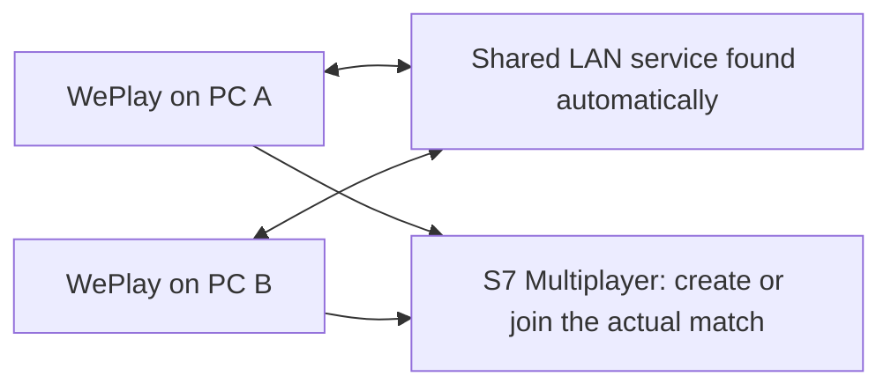

# Playing together on LAN

[Deutsch](LAN-SPIELER.md) · [Download the current RC2.1](https://github.com/R4nd0/Settlers-7-WePlay-Edition/releases/tag/v2.0.0-rc2.1)

Everyone uses the same current WePlay Setup.exe and their own supported
Settlers 7 History Edition installation. You do not enter IP addresses, start
separate servers or choose a second lobby in the launcher.

## First game: step by step

1. **Connect every PC to the same trusted home LAN.** Wired and Wi-Fi PCs can
   play together when the router permits communication between them. Guest
   Wi-Fi, client isolation, separate routed networks and some VPN setups can
   prevent discovery. For this trusted LAN, select the Windows **Private**
   network profile; WePlay’s LAN permission applies to that profile.
   [Microsoft’s network-profile instructions](https://support.microsoft.com/en-gb/windows/experience/connectivity-networking/essential-network-settings-and-tasks-in-windows).
2. **Install the same RC2.1 on every PC.** Run Setup.exe, let it find the original
   game and complete the separate game copy. Once ready, use the one WePlay
   shortcut. English and German can be selected at the top.
3. **Use a common graphics mode for the first test.** Modern graphics (DXVK)
   on every supported PC is the recommended starting point. GPU models,
   resolutions and image-quality settings do not have to be identical. See
   the renderer explanation below if one PC cannot use Modern graphics.
4. **Start one PC first.** Open **LAN play**, enter your player name and click
   **Start LAN play**. Wait for S7 to reach its multiplayer menu. If LAN access
   is blocked, use **Allow private LAN access** in WePlay on the affected PC
   and approve the corresponding Windows prompt. Keep the firewall enabled;
   no router port forwarding is needed for a normal same-LAN game.
5. **Start the other PCs the same way.** They automatically find and connect
   to the existing WePlay group. In S7, one player creates the actual match
   under **Multiplayer**; the others join it there. This is the only match
   selection. In RC2.1, **Private game is automatically unchecked and disabled**.
   Private sessions are hidden and cannot be joined through the current LAN
   flow. Do not look for another room list in the launcher.

Keep WePlay running or minimized while playing. Keep the PC running the shared
LAN service powered on and connected until everyone finishes. Quit S7 normally
when done; WePlay handles its background services.

The game’s **Private game** checkbox is separate from the Windows **Private
network** profile: leave the game checkbox off, while using the Windows Private
profile for your trusted home LAN.

## What discovery does

WePlay asks the local network whether another WePlay coordination service is
already available. Replies are checked against their actual network source,
confirmed with the live service, and checked for the supported game/patch
fingerprint. It does not sweep every address or contact a public matchmaking
server.

If no service exists, a PC starts one automatically. If a usable group already
exists, later PCs reuse it. An active group takes priority. Simultaneous first
starts use a consistent ordering and repeated checks; an incompatible winner
or conflicting active groups produce an error rather than silently separating
friends into disconnected lists.

The shared service helps the PCs find each other. **It is not the actual game
match.** The PC running that service can differ from the player hosting a
particular match. Leaving that PC's own match does not deliberately stop other
players' coordination, but shutting down or disconnecting that PC does. Moving
a running group's coordinator to another PC is not supported. An empty service
normally ends after about a minute.

## Do different render paths break the game?

**That has not been established.** The known desync is still open; there is no
verified result proving that native versus DXVK rendering caused it, or that
removing native rendering would fix it.

The current safety check compares complete prepared file sets. A native
Compatible profile and a Modern DXVK profile have different fingerprints.
Consequently, they are not admitted as an unchecked mixed group. Before
starting S7, the desktop launcher can align a known renderer difference to the
existing group. If the required mode is unsupported or other files differ,
it stops instead of admitting the player.

For an uncomplicated first test, use **Modern graphics (DXVK) on every PC**
that passes its graphics check and start one PC before the others. If two PCs
start simultaneously with different profiles, wait for the message and retry
LAN start; the launcher can then align to the visible group. Do not replace
DLLs manually or combine different RC packages.

There is **one current RC2.1 download**. Compatible graphics inside that installer
is a hardware fallback, not a second older RC release. It remains guarded by
the same matching rules. A PC that cannot support the group's required profile
cannot join that group in this configuration.

## If it does not connect

| What you see | What to do |
| --- | --- |
| Friends or matches are missing | Confirm everyone clicked Start LAN play, uses the same trusted LAN and RC2, and allows private LAN access. Check that guest/client isolation is not separating the PCs. |
| Different version or graphics profile | Use the same RC2.1. For a fresh test, exit the games, let the unused service end (about one minute), select the same supported mode and start one PC first. |
| Several active groups or a changing LAN | Finish/exit those games, allow the groups to become empty, then restart one PC first and the others afterward. Do not try to merge ongoing matches. |
| Required graphics mode unsupported | That PC cannot join the existing group's mode. A matching supported profile is required; bypassing the file check is not a solution. |
| The game starts and later reports a desync | Discovery and admission succeeded, but simulation stability failed. The known desync is unresolved; successful discovery is not a promise of a stable long match. |

This RC has not been newly qualified for three or more real clients, large
endgame networks or long sessions. [Exact verification scope](RC2-QA.md) ·
[Technical LAN details](AUTOMATIC-LAN.md)
